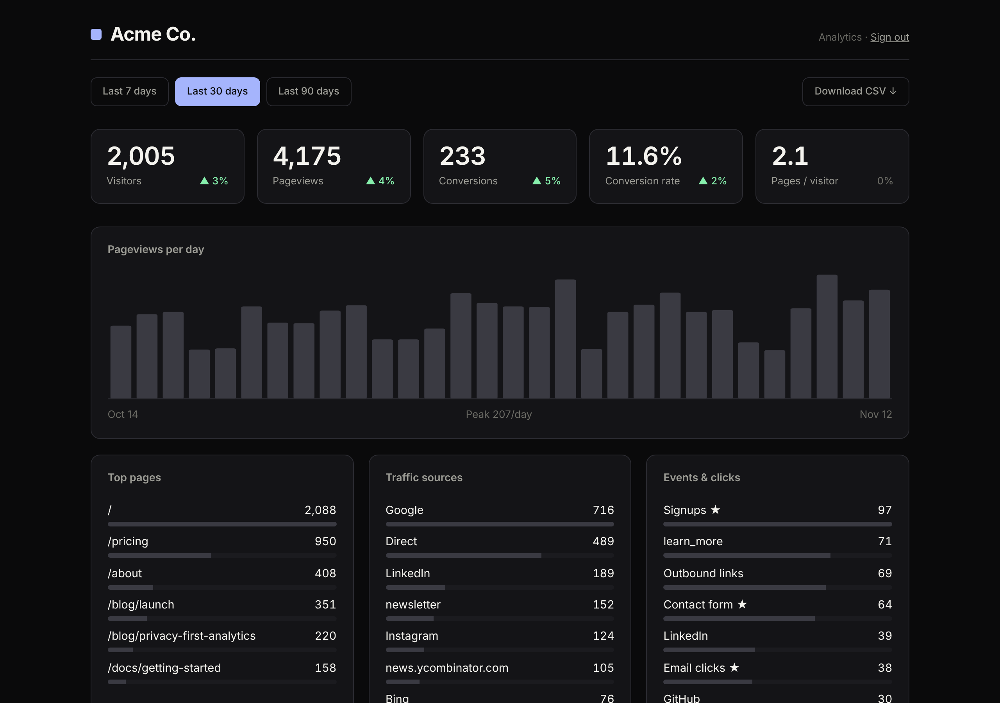
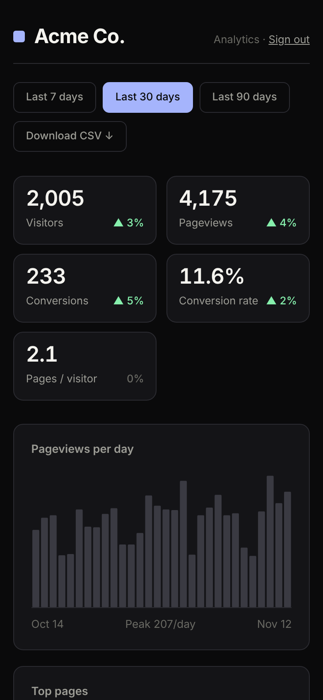

# Analytics Dashboard

**Privacy-first web analytics you host yourself**: a tiny tracking script and a login-protected dashboard. No cookies, no third-party scripts, and your data stays in one SQLite file.

**Next.js 16 · React 19 · TypeScript · SQLite (Node's built-in `node:sqlite`)**. The only runtime dependencies are Next and React.



## Features

- **Visitors, pageviews, conversions, conversion rate, pages per visitor**, each compared with the previous period.
- **Daily chart** with per-day tooltips, and 7, 30 or 90-day ranges.
- **Top pages, traffic sources, events, devices, browsers, cities and countries.**
- **Sources** come from the referrer (Google, LinkedIn, Hacker News…) or `?utm_source=`. Navigation between your own pages is excluded, including client-side navigations in single-page apps.
- **Events without code**: add `data-track="signup"` to any link, button or form. `mailto:`, `tel:`, social and outbound links are tracked automatically, and `window.track('purchase')` works from JS.
- **Configurable conversions** (★ on the dashboard) and **CSV export**.
- **Bots filtered**, ingestion rate-limited per address, and data older than ~13 months pruned.
- Responsive down to phone width.



## Try it locally

Requires Node 22.18+.

```bash
npm install
npm run setup -- --demo   # writes .env.local; login is demo / demo
npm run seed              # 180 days of realistic fake traffic
npm run dev
```

- <http://localhost:3000/>: a small demo site with the tracker installed. Click around.
- <http://localhost:3000/dashboard>: watch those clicks appear.

For a real install run `npm run setup` without `--demo`. Every setting is in [`.env.example`](.env.example).

## Add it to a site

**A Next.js site (this app):** the `<Tracker />` component is already in the demo layout. It records a pageview on every route change.

**Any other site:**

```html
<script src="https://your-analytics-host/track.js" defer></script>

<a href="/signup" data-track="signup">Start free trial</a>
<form action="/contact" data-track="contact">…</form>
```

`/track.js` serves the same TypeScript tracker ([`lib/tracker.ts`](lib/tracker.ts)) as a standalone script. It sends `text/plain` beacons, so cross-origin requests need no CORS preflight.

## How privacy works

- **No cookies or storage.** A visitor ID is an HMAC of IP + user agent + **today's date**, keyed with your secret. It can't be reversed and can't follow anyone across days.
- **No raw IPs are stored, and no outside lookups are made.** Location comes from your host's geo headers (Vercel's `x-vercel-ip-*`, Cloudflare's `cf-ipcountry`) when present.
- **Spoof-resistant client IP.** Only the `X-Forwarded-For` entry added by your own proxy is believed (set `TRUSTED_PROXIES`). Next.js doesn't expose the socket address, so always run it behind a proxy, as every host does.

## How it's built

```
app/
  (site)/              demo site + <Tracker />
  api/track/route.ts   ingestion: size cap, rate limit, bot filter, parsing → SQLite
  track.js/route.ts    the tracker as a drop-in script
  dashboard/           page (server component), login, server actions, CSV export
lib/
  tracker.ts           browser tracker (self-contained)
  tracking.ts          UA parsing, sources, visitor ID, client IP, geo
  reports.ts           dashboard queries
  auth.ts, session.ts  scrypt password + signed session cookie (no session store)
  db.ts, config.ts     node:sqlite connection + schema, env config
scripts/               setup + demo seed (run directly by Node, no build step)
tests/                 node:test, no test framework needed
```

- **Auth**: a single admin with an scrypt hash in the environment and an HMAC-signed, expiring cookie. Changing the password invalidates every session. Login attempts are counted *before* the password is checked, so parallel bursts can't slip past the limit. Server Actions provide the origin check that hand-written CSRF tokens used to.
- **No ORM, no query builder.** Every query is a fixed, parameterized SQL string. The dashboard breakdowns are a lookup table of queries, so no column name ever comes from input.

## Scripts

| | |
|---|---|
| `npm run dev` / `build` / `start` | Next.js |
| `npm test` | unit tests (`node --test`) |
| `npm run typecheck` | `tsc --noEmit` |
| `npm run setup` | create or update `.env.local` (also changes the password) |
| `npm run seed` | demo data (`-- --reset` to replace) |

## Deploying

It needs a Node host with a persistent disk for the SQLite file (Render, Fly.io, Railway, a VPS). Serverless platforms with ephemeral filesystems would need the database moved to a hosted SQLite such as Turso. Set the variables from `.env.example`, run `npm run build && npm start` behind the platform's proxy, and back up `data/`.
